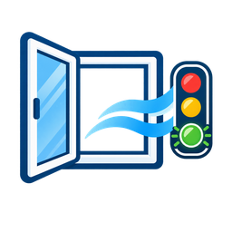

  

# Lüftungsassistent

**Wissen, wann Lüften sinnvoll ist – und wann das Fenster besser geschlossen bleibt.**

Lüftungsassistent ist eine Integration für **Home Assistant**. Sie verbindet die Messwerte deiner Räume mit Wetter, Außenluftqualität und amtlichen Warnungen und macht daraus verständliche Empfehlungen. Statt starrer Zeitpläne berücksichtigt sie, was gerade drinnen und draußen passiert.

> [!IMPORTANT]
> **Alpha-Version:** Das Projekt wird weiterentwickelt und ist noch nicht in jeder Geräte- und Warnquellenkombination getestet. Die Empfehlungen ersetzen weder amtliche Warnungen noch die eigene Einschätzung vor Ort.

**Voraussetzungen:** Home Assistant **2026.6.0 oder neuer** · HACS für die empfohlene Installation · je Raum ein Temperatur- und ein Luftfeuchtesensor

## Auf einen Blick

| | Das bringt dir Lüftungsassistent |
| --- | --- |
| 🌡️ **Raumklima** | Empfehlungen anhand von Temperatur, relativer und absoluter Feuchte; optional CO₂, Luftschadstoffe und weitere Sensoren |
| 🌤️ **Außenbedingungen** | Wetter, Regen, Wind und Außenluftqualität – auf Wunsch automatisch passend zum Standort |
| 🛡️ **Sicherheit** | Amtliche Warnungen, nachvollziehbare Sperrgründe und vorsichtiger Umgang mit unklaren Daten |
| 🌙 **Nachtlüftung** | Ein zusätzlicher Ausblick, wann längeres Lüften in der Nacht sinnvoll sein könnte |
| 🪟 **Fensterkontakte** | Erkennt laufende Lüftungen und merkt sich bestätigte Lüftungsvorgänge |
| 📊 **Dashboard & Verlauf** | Kompakte Raumkarten, Mehrraumübersicht und eine optionale Historienkarte |
| 🏠 **Mehrere Installationen** | Mehrere lokale Instanzen und optionaler Zugriff auf ein zweites Home Assistant über Tailscale |

Du brauchst dafür keine komplette Sensorlandschaft: **Temperatur und Luftfeuchtigkeit innen genügen für den Einstieg.** CO₂, Fensterkontakte, zusätzliche Luftsensoren und eigene Außensensoren sind optional.

## In wenigen Schritten starten

1. Öffne **HACS** in Home Assistant.
2. Füge unter **⋮ → Custom repositories** das Repository `https://github.com/svemmiii/lueftungsberater` als Typ **Integration** hinzu.
3. Installiere **Lüftungsassistent** und starte Home Assistant neu.
4. Öffne **Einstellungen → Geräte & Dienste → Integration hinzufügen** und wähle **Lüftungsassistent**.
5. Lass Wetter und Warnungen zunächst auf **Automatisch**, wenn du keine eigenen Quellen verwenden möchtest.
6. Lege deinen ersten Raum an und wähle Temperatur- und Feuchtesensor aus.
7. Füge im Dashboard die Karte **Lüftungsassistent – Raum** oder **Lüftungsassistent – Übersicht** hinzu.

Alles Weitere – von eigenen Warnquellen über Fensterkontakte bis zu Benachrichtigungen – lässt sich später ergänzen. Wenn bereits eine Installation vorhanden ist, **aktualisiere sie, statt sie zu löschen**. Vor einem Update empfiehlt sich ein Home-Assistant-Backup.

[**Einrichtung und Optionen im Detail →**](docs/EINRICHTUNG.md)

## Was zeigt die Empfehlung an?

Der Assistent wägt mehrere Gründe gemeinsam ab: Ist die Luft im Raum zu feucht? Hilft die Außenluft beim Abkühlen? Ist der CO₂-Wert hoch? Würden Regen, Wind oder schlechte Außenluft das Lüften gerade unvorteilhaft machen?

Du kannst zwischen zwei Ampelperspektiven wählen:

| Ansicht | Wofür die Farbe steht |
| --- | --- |
| **Lüftungsbedarf** (Standard) | Wie dringend der Raum frische Luft braucht |
| **Lüftungsampel** | Wie günstig die aktuellen Bedingungen zum Lüften sind |

Beide Darstellungen verwenden dieselbe Entscheidungslogik. Die Raumkarte erklärt zusätzlich, **warum** sie etwas empfiehlt. Eine echte Sicherheitssperre wird getrennt mit einem **🔒** angezeigt und hat Vorrang vor normalen Lüftungsempfehlungen.

[**Mehr zur Entscheidungslogik →**](docs/FUNKTIONEN.md)

## Amtliche Warnungen und Fenstersicherheit

Eine passende amtliche Warnung mit **eindeutig angekündigten Böen ab 90 km/h** kann das Lüften bereits **30 Minuten vor dem erwarteten Beginn** sperren. Auch eine ausdrücklich geltende amtliche Anweisung zum Schließen von Fenstern oder zum Vermeiden von Außenluft kann eine Sperre auslösen. Standort, Gültigkeitszeit und Einschränkungen werden dabei berücksichtigt.

**Wichtig:** Starke *gemessene* Windböen ohne passende amtliche Meldung beeinflussen die normale Wetterbewertung, erzeugen aber nicht automatisch denselben amtlichen Hardlock. Eine Warnfarbe allein bedeutet ebenfalls noch keine absolute Fenstersperre. Bei fehlender Warnabdeckung wird keine Entwarnung vorgetäuscht.

Automatische amtliche Quellen hängen vom Land ab: In Deutschland ist unter anderem NINA eingebunden, in weiteren unterstützten Regionen nationale Dienste oder Wetterwarnungen über CAP/MeteoAlarm bzw. NWS. Welche Warnarten tatsächlich abgedeckt sind, wird kenntlich gemacht.

[**Warnungen, Hardlocks und Quellen genau erklärt →**](docs/WARNUNGEN.md) · [**Abdeckung der Anbieter →**](PROVIDER_COVERAGE.md)

## Karten und Verlauf

- **Raumkarte:** Zeigt Empfehlung und Status im kompakten Modus. Bei Bedarf klappst du Gründe, Messwerte und Details aus. Nachtlüftungshinweise und aktive Sperren bleiben sichtbar.
- **Übersicht:** Fasst mehrere Räume zusammen; die Detailkarte öffnet sich erst beim Antippen.
- **Historienkarte:** Zeigt vorhandene Messwertverläufe. Optional können zusätzliche Historien ab der Aktivierung aufgezeichnet werden – frühere Werte werden nicht nachträglich erfunden.

[**Dashboard-Karten →**](docs/DASHBOARD.md) · [**Historienkarte einrichten →**](docs/HISTORIE.md)

## Sprachen, Daten und Datenschutz

Die Benutzeroberfläche und die eigenen Empfehlungen stehen auf **Deutsch, Englisch und Türkisch** zur Verfügung. Amtliche Originaltexte werden nicht automatisch übersetzt. Die Auswertung strukturierter Warnfelder ist von der Oberflächensprache getrennt; bei Freitexten hängt die Erkennung weiterhin von den unterstützten Sprachmodulen und Formulierungen ab.

Ohne Tailscale-Remote bleiben deine Raum- und Home-Assistant-Sensordaten lokal. Für automatische Wetter-, Luftqualitäts- und Warnquellen werden externe Dienste abgefragt. Eine eingerichtete Tailscale-Verbindung überträgt aktuelle, freigegebene Raum-Snapshots, aber keine vollständige Recorder-Historie.

[**Tailscale-Remote →**](docs/REMOTE.md)

## Dokumentation

| Thema | Beschreibung |
| --- | --- |
| [Einrichtung](docs/EINRICHTUNG.md) | Installation, Sensoren, Einstellungen, mobile Standorte und Benachrichtigungen |
| [Funktionen](docs/FUNKTIONEN.md) | Raumklima, Wetter, Nachtlüftung, Sitzungen und Datenqualität |
| [Warnungen](docs/WARNUNGEN.md) | Sicherheitsregeln, amtliche Quellen, Grenzen und mehrsprachiges CAP |
| [Dashboard](docs/DASHBOARD.md) | Raumkarte, Übersicht und Anzeigeoptionen |
| [Historie](docs/HISTORIE.md) | Historienkarte, Beispielkonfiguration, Recorder und Aufbewahrung |
| [Tailscale-Remote](docs/REMOTE.md) | Einrichtung, Berechtigungen, Datenschutz und Fehlerfälle |
| [Häufige Fragen](docs/FEHLERBEHEBUNG.md) | Typische Probleme und Hinweise zur Fehlermeldung |
| [Änderungen](CHANGELOG.md) | Zusammenfassung von v0.11.9 und Link zu veröffentlichten GitHub-Releases |

## Probleme melden und mithelfen

Etwas funktioniert nicht wie erwartet? Bitte öffne ein [GitHub-Issue](https://github.com/svemmiii/lueftungsberater/issues) und nenne nach Möglichkeit deine Home-Assistant-Version, die Version des Lüftungsassistenten, betroffene Sensoren und die entsprechenden Protokollmeldungen. **Bitte keine Zugangstoken, Standortkoordinaten oder anderen privaten Daten veröffentlichen.**

Die Integration ist als **Alpha** gekennzeichnet. Nicht jeder Wetterdienst und nicht jedes Land besitzt eine vollständige amtliche Warnabdeckung.

**Lizenz:** [MIT](LICENSE) · **Releases:** [GitHub](https://github.com/svemmiii/lueftungsberater/releases)
